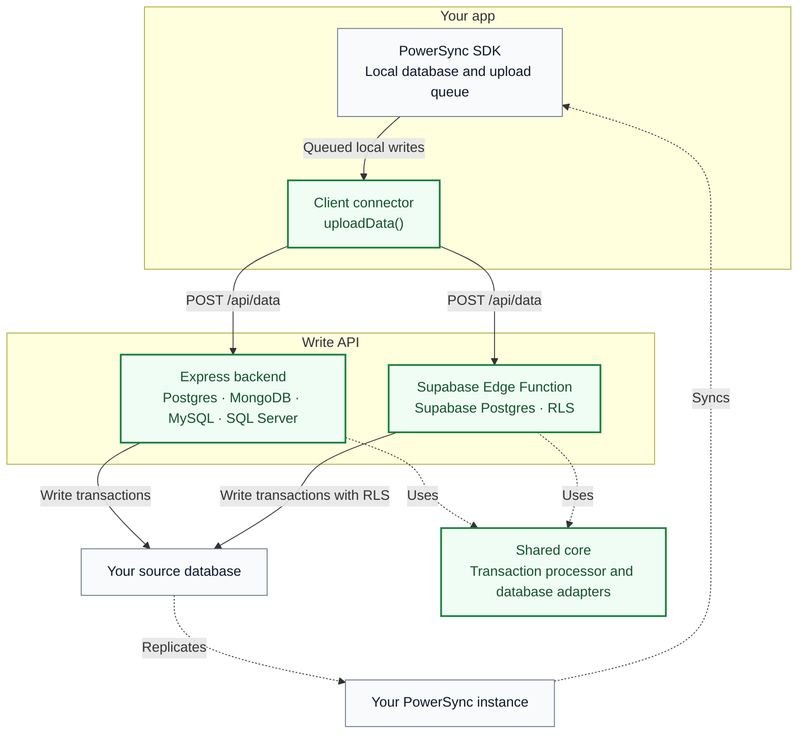

# PowerSync Reference Write Implementation

When your PowerSync app writes data using SQL INSERT, UPDATE, or DELETE statements,
PowerSync automatically queues these mutations for processing using the `uploadData` function.

While there are no restrictions on the implementation of `uploadData` and the related write API,
this repository provides a client connector and two implementations of the write API for most simple use cases.
It provides extension points that will allow you to customize
the behavior to your own requirements, or you can modify it to suit your specific case.

- [backend/shared/powersync-reference-write-api.openapi.yaml](backend/shared/powersync-reference-write-api.openapi.yaml) provides a simple but flexible API definition that serves as a contract between the client connector and either backend.
- A [client connector](example-client/src/PowersyncConnector.ts) implementing `uploadData` handles most common workflows. It will marshal queued changes to the format specified by the API definition. A [single-file client connector](example-client/src/PowersyncConnector.singlefile.ts) is provided for ease of copy-paste.
- The write API (`POST /api/data`) accepts queued transactions from the client connector and applies them to your source database. Choose the [standalone Express backend](backend/standalone/README.md), or, for Supabase apps, the [Supabase Edge Function](backend/supabase/README.md), which implements the same write API and enforces your existing RLS policies. Both use the [shared core](backend/shared), which contains the transaction processor and adapters for Postgres, MongoDB, MySQL, and SQL Server.

The green blocks are provided by this repository; click them to explore the code. Solid arrows
show the write path, dotted arrows show shared-code dependencies and the existing sync path.
Choose one backend to serve the write API (`POST /api/data`).



Both backends implement the [same write API contract](backend/shared/powersync-reference-write-api.openapi.yaml).
The shared core runs inside your chosen backend; it is not a separate service.

You supply the database, PowerSync instance, app, and application-specific authorization, and you must copy a client connector into your app.

## Setup

Run the commands below from the repository root. `docker compose` runs the Express backend;
local development and tests use Node.js 24 and pnpm 9.

### 1. Configure the database

Configure the connection to the source database that your PowerSync instance replicates from.

Set these in `.env.local` (or the root `.env` for shared defaults) for Docker Compose:

| Variable | Meaning |
| --- | --- |
| `DATABASE_TYPE` | `postgres` (default), `mongodb`, `mysql`, or `mssql` |
| `DATABASE_URI` | Required connection string for your source database |
| `BATCH_ON_FATAL_ERROR` | `stop` (default) or `skip`; see [error handling](docs/error-handling.md) |

Connection string notes: percent-encode special characters in passwords. Postgres accepts `?sslmode=require` (or `verify-full`) for managed databases. MSSQL verifies the server certificate by default; add `?trustServerCertificate=true` only for self-signed development servers. Missing ports default to 5432 (Postgres) and 1433 (MSSQL). Pools are capped at 10 connections with connect and statement timeouts.

`.env` is committed, so keep it to shared defaults. Put this machine's values and any secret, such
as a `DATABASE_URI` with a password, in `.env.local`. This is gitignored, optional, and
overrides `.env`. Compose passes both files to the container, so `docker compose up` needs no extra
flags.

Tables and columns must match uploaded operations unless you add custom [schema mapping](docs/schema-mapping.md).
Each table also needs an `id` primary key or unique column holding the client's row ID; see
[row ID](docs/schema-mapping.md#row-id).
The default MongoDB mapper also requires collection `$jsonSchema` validators.

In Docker Desktop, use `host.docker.internal` to reach a database on the host.
For the Express backend running directly on the host, use the database's host-accessible address,
such as `localhost`. Other Docker environments may require a host-gateway configuration.

### 2. Configure authentication

The Express backend accepts tokens signed by keys it trusts, normally the same provider your PowerSync instance trusts,
so your app authenticates with the same provider for read and write.
The default `backend/standalone/src/auth/verifier.ts` reads a PowerSync Cloud JSON export, resolves its authentication settings, and builds a verifier.
It may need additional trusted settings, such as the expected issuer or audience.

Choose an integration:

- **PowerSync Cloud or self-hosted PowerSync:** save your config as
  `backend/standalone/config/powersync-config.json` (the default) and set any `AUTH_*` supplements; see
  [auth setup](docs/auth/setup.md#config-file-default).
- **Any other provider (Clerk, Auth0, Supabase):** set `AUTH_MODE=env` with your issuer,
  audience and JWKS URL, no file needed. See [auth setup](docs/auth/setup.md#environment-variables-only)
  and the [Supabase and Clerk guide](docs/auth/providers.md).
- **Trying it out with no provider:** use
  [PowerSync development tokens](docs/auth/development-tokens.md).

### 3. Start the Express backend

```bash
docker compose up --build
```

The Express backend listens at `http://localhost:6060`. Compose fixes both the container and host
port to 6060; change its `ports` mapping to expose a different host port.

Startup checks the database type, connection string, fatal-error policy, and verifier configuration.

### 4. Connect your app

Copy a client connector from [example-client](example-client/README.md) into your app. Configure
its write API URL, PowerSync instance URL, and token retrieval, then pass it to your existing
PowerSync database's `connect()` method. The client connector implements:

- `fetchCredentials()`: credentials for the PowerSync sync connection. If your app is already reading data from PowerSync then you will have already implemented this function, we recommend that you keep your existing implementation and configure the Express backend to trust the same issuers - see [auth setup](docs/auth/setup.md).
- `uploadData()`: sends queued local transactions to `POST /api/data`.

Use a URL reachable from the client device. `localhost` refers to that device, so another
computer or phone needs the Express backend's network address or a tunnel URL.

## Before production

- [ ] **Configure write authorization.** The Express backend allows all authenticated writes
  by default. Add [application checks or effective Postgres RLS](docs/auth/authorization.md).
  For the Supabase Edge Function, verify that [grants and RLS policies](backend/supabase/README.md#authorization)
  cover every writable table and operation.
- [ ] **Replace demo authentication.** Integrate your provider's session and token refresh
  handling instead of using a fixed demo token; see [client authentication](example-client/README.md#authentication).
- [ ] **Decide how rejected writes are recovered.** By default, backend-directed fatal failures
  are logged and removed from the client queue. The dead-letter hook provides no durable storage
  or guaranteed delivery. Implement recovery appropriate to your application; see
  [error handling](docs/error-handling.md).
- [ ] **Handle blocked uploads.** Client-directed failures remain queued and block later uploads.
  Implement a user-facing resolution flow through
  [`onFatalTransaction`](docs/error-handling.md#response-and-queue-behavior).
  Review the [authorization-failure defaults](docs/error-handling.md#authorization-failure-defaults):
  Supabase RLS errors are retried, while denials from its optional custom authorizer are removed
  from the queue by default.
- [ ] **Validate application data and mapping.** Review writable tables, fields, ownership, and
  value validation. The [default mapping](docs/schema-mapping.md#default-mapping) is not
  application-specific validation.
- [ ] **Review conflict and retry behavior.** Confirm the documented
  [conflict-resolution behavior](docs/conflict-resolution.md) suits your app, and make custom
  writes and side effects safe when an upload is repeated.

## Application behavior

The Express backend's default authorizer allows all authenticated writes. Add your application's checks in
[`backend/standalone/src/auth/authorizer.ts`](backend/standalone/src/auth/authorizer.ts); see
[authorization](docs/auth/authorization.md). On the Supabase Edge Function, your RLS policies
authorize each write and the authorizer is optional; see
[Supabase authorization](backend/supabase/README.md#authorization). Configure your PowerSync Sync Streams
separately to control which rows each user can read.

[Schema mapping](docs/schema-mapping.md) describes field conversion and custom writes.
[Error handling](docs/error-handling.md) explains rejected transactions, queue retention,
and the optional dead-letter callback.

[Conflict resolution](docs/conflict-resolution.md) documents the approach taken in this reference implementation, as well as alternative
conflict resolution approaches that can be implemented.

## API

`backend/shared/powersync-reference-write-api.openapi.yaml` defines the write API (`POST /api/data`).
Both backends accept 1–50 transactions and process
them in order, each in its own database transaction. Each returns one result per submitted
transaction, including `not_attempted` for transactions after the stopping point.

Processed batches return HTTP 200; inspect the individual result statuses. Request validation
and authentication failures use HTTP errors such as 400 and 401. Transaction outcomes are
`success`, `retryable_error`, `fatal_error`, or `not_attempted`.

On the Express backend, `BATCH_ON_FATAL_ERROR=skip` continues after backend-directed fatal failures. Client-directed
fatal failures and retryable failures stop the batch. See [error handling](docs/error-handling.md).

## Development

For Docker with automatic reloads:

```bash
docker compose -f docker-compose.yaml -f docker-compose.dev.yaml up --build
```

For local execution, stop the Express backend running in Compose, create `backend/.env` from
`backend/.env.template`, and configure it for your host's database address and auth setup.
The local process loads `backend/.env`; Compose reads the root `.env`.

```bash
pnpm --dir backend install
pnpm --dir backend dev
```

The local port defaults to 6060 and can be changed with `PORT` in `backend/.env`.
Rebuild the image after code changes when using Compose without the development overlay.

## Tests and API types

```bash
pnpm --dir backend test
pnpm --dir backend check
pnpm --dir backend generate-types
pnpm --dir backend generate-edge-validator
```

These tests cover the shared core and the Express backend. They use local fixtures and mocks;
they need permission to open local listening ports, but no Docker, running database, or live
identity provider. After editing the OpenAPI spec, run both generators: `generate-types` updates
`backend/shared/src/generated/api.ts` and `example-client/src/generated/api.d.ts`, and
`generate-edge-validator` updates `backend/shared/src/generated/transaction-batch-validator.ts`,
which the Edge Function uses. A test fails if the validator is stale.

### Edge Function tests

These need Docker, Deno, and the Supabase CLI. Start the local stack and serve the function from
`backend/`, then run the tests in another terminal:

```bash
cd backend
supabase start
supabase functions serve
```

```bash
cd backend/supabase/functions/powersync-write
deno task test
```

`hosted.test.ts` runs only against a deployed function and skips unless the
`POWERSYNC_TEST_HOSTED_*` variables described at the top of that file are set.
